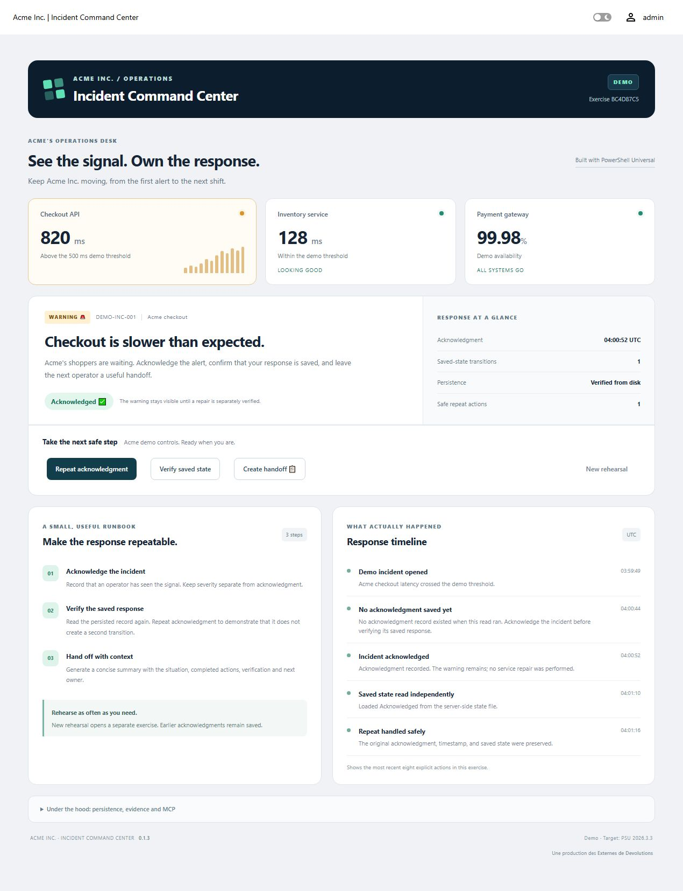

# Incident Command Center

Connect an **AI service** to **PowerShell Universal (PSU)** through
**Model Context Protocol (MCP)**. Ask questions in plain English and have your
AI service use the PowerShell tools you choose to expose.

MCP is a standard that lets an AI application connect to external tools and data.
Your AI service uses an MCP-capable client to discover and request a PSU tool.
PSU runs the PowerShell on the server and returns the result; the AI service uses
those returned facts in its reply.

**Incident Command Center (ICC) is a working example of that connection.** It uses
an incident-response rehearsal at fictional **Acme Inc.** so you can inspect a
warning, save an acknowledgment, repeat it safely and prepare a handoff. The
dashboard makes the same saved state visible. Use the pattern as a starting point
for your own selected PSU data and workflows.

**ICC 0.1.3 — Windows / PSU 2026.3.3.** This regular release is a single-server
learning example. Native workflows, superseded-tab refusal and one signed-in
Codex MCP conversation passed on the documented scope. The packaged app and MCP
installers also passed on a refreshed PSU 2026.3.3 instance with empty ICC paths.
See [the release](https://github.com/DataTraveler1/PowerShellUniversal.Apps.IncidentCommandCenter/releases/tag/v0.1.3)
and [release notes and change history](RELEASE-NOTES.md).

## FAQ

<a name="why-does-this-exist"></a>

### Why does this exist? 💡

ICC lets you try **AI service → MCP client → PSU tool → saved result** with a
small example you can inspect. Its tool, **ICC_Demo_Incident**, exposes three
bounded actions: Inspect, Acknowledge and Handoff. The incident story is a way to
learn the connection. Adapting it to your own PSU information or tasks requires
choosing and exposing the appropriate tools.

<a name="which-ai-services-can-i-use"></a>

### Which AI services can I use? 🔌

You need an **AI service with an MCP-capable client** and a model that can use
tools. That can be a commercial AI service, or an application connected to a
large language model (LLM) your organization provides. In either case, the client
must support PSU's remote HTTP MCP endpoint and app-token authentication.

Familiar options with documented MCP support include
[GitHub Copilot in VS Code](https://code.visualstudio.com/docs/agent-customization/mcp-servers),
[Codex](https://learn.chatgpt.com/docs/extend/mcp) and
[Claude Code](https://code.claude.com/docs/en/mcp).
**Only Codex has been tested with ICC.** Copilot, Claude Code and organization-provided
model setups need validation in your environment. See [MCP setup](docs/MCP.md)
for the tested connection example.

<a name="how-do-i-jump-in-and-use-it-now"></a>

### How do I jump in and use it NOW? 🤔

On a compatible Windows PSU server:

1. Download **IncidentCommandCenter-0.1.3.zip** from
   [the release](https://github.com/DataTraveler1/PowerShellUniversal.Apps.IncidentCommandCenter/releases/tag/v0.1.3)
   and verify its matching manifest and SHA-256 checksums.
2. Follow [Install](#install) below, then open `/incident-command-center`
   on your PSU server and sign in as an Administrator.
3. Follow [MCP setup and usage](docs/MCP.md) to register **ICC_Demo_Incident**
   and connect your AI service through its MCP client.
4. Try the prompt below, then refresh the dashboard to see the saved result.

If ICC is already installed, open the existing app and follow
[Updating and recovery](docs/UPGRADE.md) before rerunning an installer.

<a name="what-do-i-need"></a>

### What do I need? 🧰

Windows, **PSU 2026.3.3**, matching **Devolutions.PowerShellUniversal 2026.3.3**,
**PowerShell 7.5.4 or later**, and an existing Administrator app token.
PSU also needs an app-capable license and its **PowerShell 7** environment enabled.
The [installation section](#install) supplies the command and local module path.

<a name="do-i-need-an-ai-account-or-api-key"></a>

### Do I need an AI account or API key? 🤖

The native dashboard works without an AI account or external API. The MCP demo
uses the model access supplied by your AI service or organization, plus a PSU
Administrator app token for the client connection. Your AI service's account,
API-key or organization sign-in requirements depend on the client you choose.
In PSU, **Disable AI Features** must be off for the MCP endpoint to be available.
Keep tokens in the client's supported local secret mechanism.

<a name="what-should-i-ask-the-assistant"></a>
<a name="what-should-i-ask-the-assistant-"></a>
<a name="what-should-i-ask-the-ai-service"></a>

### What should I ask the AI service? 💬

> Use ICC_Demo_Incident. Inspect the active rehearsal first and keep its full
> exerciseId for later calls. Acknowledge the warning, inspect the saved state,
> acknowledge it again, inspect once more, and prepare a handoff. Stop if a tool
> call fails. Acknowledgment records receipt; it does not repair a service.

See the [guided conversation](docs/MCP.md#demonstrate-the-conversation) for the
expected results. Refresh the dashboard after tool calls.

<a name="is-this-monitoring-a-real-service-or-fixing-an-incident"></a>

### Is this monitoring a real service or fixing an incident? 🔎

The service signals and initial incident story are synthetic. The acknowledgment
and explicit action events are real records saved on the PSU server. Repeating
acknowledgment preserves the original response and one
state transition. Acknowledgment records receipt of a warning and performs no
service repair.

<a name="is-this-ready-for-production-or-tested-on-other-platforms"></a>

### Is this ready for production or tested on other platforms? 🚧

This is a **single-server learning example**. Release 0.1.3 passed
isolated native and MCP runtime checks on Windows Server 2019 with the PSU/module
**2026.3.3** pair, PowerShell **7.6.6** and Codex CLI **0.162.0-alpha.17.2**.
Actual clean app/tool installation passed on a refreshed PSU 2026.3.3 instance. Linux, other PSU
releases or clients, custom service identities and multiple nodes remain untested.
Assess and test any adaptation for your environment.

<a name="what-if-setup-stops-or-i-want-to-start-another-rehearsal"></a>

### What if setup stops, or I want to start another rehearsal? 🔄

Fresh installers stop on existing names, routes or installation folders; use
[Updating and recovery](docs/UPGRADE.md) to inspect and reuse an existing setup.
For another exercise, choose **New rehearsal** in the app. All viewers share
the active rehearsal, so coordinate first. Earlier exercise data is retained;
there is no automatic cleanup.

**ICC 0.1.3 targets Windows with PowerShell Universal 2026.3.3 and
Devolutions.PowerShellUniversal 2026.3.3.** The service signals are synthetic;
acknowledgment is stored on disk. This learning example uses one shared active
rehearsal on one PSU server.



Recorded ICC 0.1.3 clean-install native workflow after **Create handoff**: one saved-state
transition, one safe repeat and three completed runbook steps. Handoff completion
is specific to the browser session. Captured October 15, 2026 UTC.

## Install

Run on the Windows server hosting PSU using **PowerShell 7.5.4 or later**.
You need the exact PSU/management-module 2026.3.3 pair, an app-capable PSU license,
an enabled **PowerShell 7** environment and an existing Administrator app token.

Extract **IncidentCommandCenter-0.1.3.zip** from
[the release](https://github.com/DataTraveler1/PowerShellUniversal.Apps.IncidentCommandCenter/releases/tag/v0.1.3).
Open an elevated PowerShell 7
session in the package directory and keep the module folder beside the installer.
For the standard PSU Windows installation:

```powershell
$token = Read-Host 'PSU Administrator app token' -AsSecureString
.\Install-IncidentCommandCenter.ps1 -ServerUrl http://localhost:5000 -AppToken $token -ManagementModulePath 'C:\Program Files (x86)\Universal\Modules\Universal\Devolutions.PowerShellUniversal.psd1'
Remove-Variable token
```

Use your actual local origin if the port differs. The installer accepts localhost,
IPv4/IPv6 loopback or the server's machine name. It checks exact server and module
versions, keeps authentication enabled and grants access only to Administrator.
The bundled directory named `Universal` contains the current Devolutions manifest.
`-ManagementModulePath` requires an existing local absolute `.psd1` path; omit it
only when exact-version module discovery is available.

Open `/incident-command-center` and sign in as an Administrator. The first visit
creates a rehearsal. App and automation processes need access to the shared
exercise files.

Existing names, routes and installation folders stop a fresh installation.
`-WhatIf` still reads the server before skipping writes. For an occupied or partial
installation, use [Updating and recovery](docs/UPGRADE.md).

## Use the app

1. **See the signal.** Checkout latency is 820 ms against a 500 ms demo threshold.
2. **Acknowledge.** Record that an operator has seen the warning.
3. **Verify saved state.** Read the stored acknowledgment again.
4. **Repeat safely.** Preserve the first response, timestamp and one transition.
5. **Create handoff.** Summarize the situation, action, verification and next owner.

Acknowledgment does not repair a service; the warning remains visible.
Before acknowledgment, **Verify saved state** reports that no acknowledgment
exists yet and leaves persistence unverified. If prior actions reference an
acknowledgment whose file is missing, ICC stops and requests complete-backup
recovery rather than silently reopening the incident. See [recovery](docs/UPGRADE.md#missing-acknowledgment-data).
**New rehearsal** creates a separate exercise and retains previous exercise data.
All viewers share the current rehearsal. Coordinate before replacing it.
Each native button carries the rehearsal ID shown when it rendered. Native
actions and MCP calls reject superseded exercise IDs; refresh the app or Inspect
the current exercise before continuing.

## Try the MCP demo

Follow [MCP setup and usage](docs/MCP.md) to connect your AI service's MCP client.
The tool exposes Inspect, Acknowledge and Handoff through PSU's MCP endpoint.
PSU runs the selected PowerShell and stores the result; your AI service provides
the conversation and uses the returned facts. Refresh ICC after chat actions.
The native dashboard works without an AI account or external API.

PSU AI features must be enabled for MCP: **Disable AI Features** must be off.
Use an existing Administrator token through the client's local secret mechanism.
Never commit tokens or client credentials.

## Tests and scope

ICC 0.1.3 runtime qualification on October 15, 2026 UTC (October 14 local):
338 offline checks passed, plus 47 recovery/concurrency checks in fresh scratch
stores on the Windows server. The actual native workflow and all three stale-tab
actions passed. One signed-in Codex session made six native HTTP MCP calls;
its facts and complete handoff matched six Completed PSU jobs and saved state.

The earlier runtime check used a separate app, data root and stable qualification
tool alias. On October 15, the actual unchanged packaged app and MCP installers
passed on refreshed PSU 2026.3.3 after residual folders were preserved outside
the active paths. The standard app and tool share the default data root; native
use and one direct MCP Inspect passed, matched to its Completed PSU job.
The 71 installer scenarios remain simulated supplemental coverage.
Release 0.1.3 is published as a regular release for this measured scope; this does
not establish production readiness or compatibility with untested environments.

| Tested component | Version |
| --- | --- |
| PSU and Devolutions.PowerShellUniversal | 2026.3.3 |
| PowerShell runtime | 7.6.6 |
| Codex CLI MCP client | 0.162.0-alpha.17.2 |

PowerShell 7.5.4 is the package minimum. The offline suites use isolated state
and simulated installer commands, without PSU or credentials:

```powershell
pwsh -NoProfile -File .\tests\Test-IncidentCommandCenter.ps1
pwsh -NoProfile -File .\tests\Test-IccMcp.ps1
pwsh -NoProfile -File .\tests\Test-IccInstallers.ps1
pwsh -NoProfile -File .\tests\Test-IccWorkflow.ps1
pwsh -NoProfile -File .\tests\Test-IccStateRecovery.ps1
pwsh -NoProfile -File .\tests\Test-IccNativeBinding.ps1
```

Outputs go under ignored `output/` storage. The example has not been tested on
Linux, other PSU releases, other clients, custom service identities or multiple
nodes. It supplies fixed signals and a demo timeline, with no monitoring connector,
automatic remediation or human-attributed audit log.

The AI introduction in the main-branch documentation was updated on October 15,
2026 after the release. The **v0.1.3 tag and downloadable package retain their
original reviewed source and documentation**. See the [dated documentation update](RELEASE-NOTES.md).

## Code and data

- `PowerShellUniversal.Apps.IncidentCommandCenter/`: module, dashboard, styles and state engine.
- `Install-IncidentCommandCenter.ps1`: app installer.
- `Install-IccMcpTool.ps1` and `mcp/`: optional MCP tool installer and wrapper.
- `tests/`: offline checks.
- `docs/`: [MCP](docs/MCP.md), [architecture](docs/ARCHITECTURE.md) and [updating/recovery](docs/UPGRADE.md).

Code installs under `%ProgramData%\PowerShellUniversal\Showcases\IncidentCommandCenter\0.1.3`.
Exercise data lives separately under `%ProgramData%\PowerShellUniversal\IncidentCommandCenter`.
There is no automatic cleanup. See [architecture and removal](docs/ARCHITECTURE.md)
for shared-state behavior and deliberate removal.

## License

[Release notes and change history](RELEASE-NOTES.md).

[MIT](LICENSE). Copyright 2026 Mike Simpson. An independent community project;
PowerShell Universal and external clients retain their own licensing requirements.

*Une production des Externes de Devolutions.*
